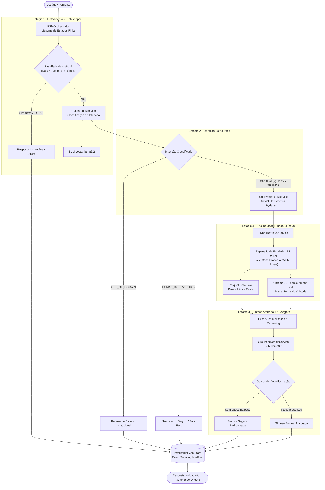
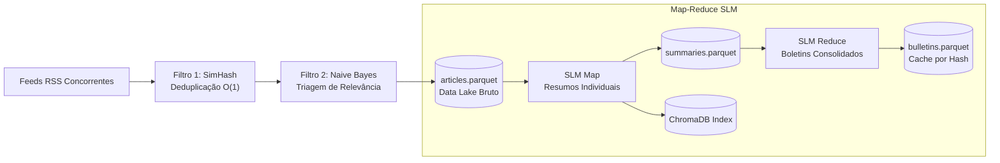

# News Summarizer - On-Premise SLM News Intelligence


O **News Summarizer** é um sistema autônomo e determinístico de inteligência e síntese de notícias baseado em *Small Language Models* (SLMs), projetado para executar **100% On-Premise (local)** em hardware de consumo (ex: GPUs com 6GB a 12GB de VRAM, como RTX 3060/4060).

O projeto adota padrões avançados de Engenharia de Software, incluindo **Clean Architecture desacoplada de frameworks monolíticos, CQRS, Event Sourcing com Pydantic v2, Funil O(1) de Deduplicação, Máquina de Estados Finita (FSM), Busca Híbrida Bilíngue e Cache Inteligente por Hash de Artigos**.

---

## 🎯 O que o Sistema Faz vs. ⛔ O que NÃO Faz

Para garantir transparência, previsibilidade e máxima eficiência operacional, o escopo do News Summarizer é estritamente delimitado:

| O que o Sistema FAZ ✅ | O que o Sistema NÃO FAZ ❌ |
| :--- | :--- |
| **Ingestão Concorrente**: Baixa e analisa dezenas de feeds RSS em paralelo com timeout de fail-fast (7s por feed). | **Sem Web Scraping Agressivo**: Não faz raspagem invasiva de HTML pesado nem quebra de paywalls de matérias fechadas. |
| **Triagem Matemática $O(1)$**: Descarta redundâncias via **SimHash (Distância de Hamming)** e filtra relevância via **Naive Bayes** antes de usar a GPU. | **Sem Desperdício de GPU**: Não gasta ciclos de inferência com notícias duplicadas ou tópicos irrelevantes. |
| **Processamento Estruturado em Lotes**: Resume notícias via SLM local em blocos configuráveis (Top N ou Tudo) e persiste de forma imutável em **Apache Parquet**. | **Sem APIs Pagas ou Nuvem**: Não depende de OpenAI, Anthropic ou qualquer serviço cloud externo (custo de inferência zero). |
| **Boletins com Cache Inteligente**: Gera boletins consolidados (Top 10, quantidade customizada ou por tema), reutilizando boletins existentes caso o conjunto de notícias já tenha sido sintetizado. | **Sem Regeração Redundante**: Se as notícias selecionadas gerarem o mesmo hash de artigos, o sistema retorna instantaneamente o boletim existente. |
| **Busca Híbrida com Equivalência Bilíngue**: Unifica busca léxica de alta precisão (Parquet) e busca vetorial semântica (ChromaDB), mapeando entidades inglês/português (ex: *Casa Branca* ⇄ *White House*, *IA* ⇄ *AI*). | **Sem Chatbot Genérico**: Não é assistente de conversação aberta (não conta piadas, não inventa receitas e não discute assuntos fora do domínio de notícias). |
| **Oráculo RAG Aterrado (Grounded)**: Responde estritamente com base nos fatos contidos nas notícias arquivadas, bloqueando conhecimentos de pré-treino de enciclopédia. | **Sem Alucinação Permissiva**: Se a informação não existir na base de dados, o oráculo recusa de forma transparente (*"Não possuo dados suficientes..."*). |
| **Fast-Paths Instantâneos (0ms / 0 GPU)**: Responde perguntas de catálogo (notícia mais recente, mais antiga) e data do sistema diretamente do armazenamento sem invocar LLM. | **Sem Dependência de Conexão Ativa no RAG**: Após ingeridas as notícias, consultas e boletins funcionam completamente offline. |
| **Auditoria e Event Sourcing Completo**: Registra cada intenção, transição de estado, extração de filtro e guardrail em um log imutável de eventos de domínio. | **Sem Caixa-Preta**: Toda resposta possui rastreabilidade com links e títulos exatos das matérias de origem. |

---

## 🏗️ Arquitetura em Estágios (Clean Pipeline)

O sistema rejeita bibliotecas "caixa-preta" e implementa um fluxo desacoplado em 4 estágios governado por uma **Máquina de Estados Finita (FSM)** e **Event Sourcing**:



### Detalhamento dos Estágios

1. **Gatekeeper & Roteamento (`GatekeeperService`)**:
   - Identifica se a intenção é `FACTUAL_QUERY`, `TRENDS_SUMMARY`, `OUT_OF_DOMAIN` ou `HUMAN_INTERVENTION`.
   - Inclui atalhos determinísticos em $O(1)$ para perguntas de catálogo (*"qual a notícia mais recente?"*, *"qual a mais antiga?"*, *"que dia é hoje?"*), respondendo em milissegundos sem gastar inferência de GPU.
2. **Extrator Estruturado (`QueryExtractorService`)**:
   - Converte a linguagem natural em filtros fortemente tipados via Pydantic v2 (`NewsFilterSchema`: tópico, palavra-chave, data, limite).
3. **Recuperador Híbrido Bilíngue (`HybridRetrieverService`)**:
   - **Busca Léxica Exata**: Varre resumos e mega-boletins no Parquet Data Lake.
   - **Busca Vetorial Densa**: Consulta o índice semântico no ChromaDB (`nomic-embed-text`).
   - **Mapeamento Bilíngue Determinístico**: Corrige automaticamente o descasamento entre consultas em português e notícias internacionais em inglês (ex: busca por *"Casa Branca"* ativa simultaneamente a varredura por *"White House"*).
4. **Oráculo Factual Aterrado (`GroundedOracleService`)**:
   - Recebe exclusivamente o contexto dos documentos recuperados.
   - Força o SLM a sintetizar **apenas os fatos noticiados**, eliminando o viés de conhecimento prévio de enciclopédia.
   - Normaliza recusas para evitar respostas vazias ou alucinações.
5. **Auditoria por Event Sourcing (`ImmutableEventStore`)**:
   - Registra todos os eventos de domínio tipados (`UserMessageReceived`, `IntentClassified`, `ContextRetrieved`, `ResponseGenerated`, etc.) de forma imutável (`frozen=True`) para inspeção de conformidade.

---

## ⚡ Funil $O(1)$, Data Lake e Map-Reduce



* **Funil de Entrada**: Usa SimHash com distância de Hamming (descarte em tempo constante de notícias duplicadas ou com títulos quase idênticos) e Naive Bayes (*cold-start* com pesos em `vocabulary_seed.json`).
* **Armazenamento Colunar Polars**: Dados brutos, resumos e boletins ficam salvos em arquivos `.parquet` com compressão e leitura colunar ultrarrápida.
* **Cache Inteligente de Boletins**: Cada boletim calcula o hash SHA-256 do conjunto de notícias sintetizadas. Se você solicitar um boletim de notícias já sintetizadas, o sistema entrega o documento existente instantaneamente.

---

## 🚀 Instalação e Execução

### Pré-requisitos
* **Python 3.12+**
* **[Ollama](https://ollama.com/)** instalado e em execução local (`http://localhost:11434`).
* Modelos baixados no Ollama:
  ```bash
  ollama pull llama3.2
  ollama pull nomic-embed-text
  ```

### Instalação

```bash
# 1. Clonar o repositório
git clone https://github.com/SEU_USUARIO/news_summarizer.git
cd news_summarizer

# 2. Criar e ativar o ambiente virtual
python -m venv .venv
source .venv/bin/activate  # Linux/macOS
# .venv\Scripts\activate   # Windows

# 3. Instalar dependências
pip install -r requirements.txt
```

### Configuração Inicial de Feeds e Vocabulário

Copie os modelos de configuração para criar seus arquivos locais:

```bash
# Feeds RSS para monitorar
cp feeds.example.json feeds.json

# Vocabulário e pesos para triagem Bayesiana inicial
cp vocabulary_seed.example.json vocabulary_seed.json
```

---

## 🖥️ Como Executar (Menu Principal)

Inicie a aplicação interativa:

```bash
python main.py
```

O menu interativo unificado disponibiliza todas as funcionalidades do sistema:

```text
===========================================================================
  📰 NEWS SUMMARIZER - Inteligência Autônoma de Notícias (SLM On-Premise)
  Arquitetura em Estágios, Clean Pipeline, CQRS & Event Sourcing
===========================================================================

=== MENU PRINCIPAL ===
[1] Ingestão de Notícias & Funil O(1) (RSS -> SimHash -> Naive Bayes)
[2] Processar & Indexar Notícias (SLM Map -> Parquet -> ChromaDB)
[3] Gerar Boletim (Top 10 / Personalizado / Por Tema)
[4] Visualizar Histórico de Boletins Gerados
[5] Visualizar Sumários Individuais de Notícias (Navegar / Buscar)
[6] Conversar com o Oráculo RAG (Modo Estrito Anti-Alucinação)
[7] Trilha de Auditoria (Event Sourcing da Sessão)
[0] Sair
```

### Guia Rápido das Opções

* **Opção [1]**: Realiza a ingestão assíncrona de todos os feeds RSS configurados em `feeds.json`, descartando duplicatas em $O(1)$.
* **Opção [2]**: Executa o estágio **MAP**, gerando sumários estruturados via SLM local e indexando vetores no ChromaDB. Permite escolher lotes (ex: 10, 25) para proteger a VRAM da GPU.
* **Opção [3]**: Executa o estágio **REDUCE**, criando boletins estratégicos (Top 10, quantidade customizada ou filtro por tema). Possui cache inteligente por hash de artigos.
* **Opção [4]**: Lista o histórico de boletins arquivados em Parquet com paginação e leitura completa.
* **Opção [5]**: Permite navegar pelos resumos individuais salvos e realizar buscas por palavras-chave com destaque visual de metadados.
* **Opção [6]**: Terminal interativo do Oráculo RAG factual. Suporta consultas pontuais, meta-consultas de catálogo e perguntas bilíngues (ex: *"me fale sobre a Casa Branca"* ou *"quais os avanços em semicondutores?"*).
* **Opção [7]**: Exibe a trilha de auditoria completa da sessão, listando cada evento do Event Sourcing (intenção classificada, filtros gerados, estratégias de recuperação e guardrails).

---

## 🧪 Testes Automatizados

A base de código conta com **57 testes unitários e de integração** cobrindo filtros, clientes, orquestrador, máquina de estados, recuperador híbrido e pipelines:

```bash
pytest -v
```

Saída esperada:
```bash
============================== 57 passed in 2.00s ==============================
```

---

## 📦 Estrutura de Diretórios

```text
news_summarizer/
├── core/
│   ├── application/
│   │   ├── services/           # Gatekeeper, QueryExtractor, GroundedOracle, HybridRetriever
│   │   └── use_cases/          # IngestionService, SummarizerService, BulletinViewerService
│   ├── domain/                 # Entidades, Enums de Intenção, Modelos Pydantic e Portas (Interfaces)
│   ├── filters/                # Filtro Lexical (SimHash) e Filtro Bayesiano (Naive Bayes)
│   ├── fsm/                    # Estados da FSM e FSMOrchestrator
│   ├── infrastructure/         # Adaptador HTTP do OllamaClient
│   ├── ingestion/              # RSS Parser concorrente com fail-fast
│   └── persistence/            # ParquetStore (Polars) e ChromaDBAdapter (Hipocampo)
├── data/
│   ├── parquet/                # Data Lake colunar imutável (.parquet)
│   └── chroma/                 # Banco vetorial persistido
├── tests/                      # 57 testes unitários e testes de integração
├── feeds.example.json          # Modelo de feeds RSS
├── vocabulary_seed.example.json# Modelo de pesos do Naive Bayes
├── main.py                     # Ponto de entrada CLI interativo
├── requirements.txt            # Dependências Python desacopladas
└── README.md                   # Documentação do projeto
```

---

## 🤝 Licença

Distribuído sob a licença MIT. Consulte o arquivo `LICENSE` para mais detalhes.
