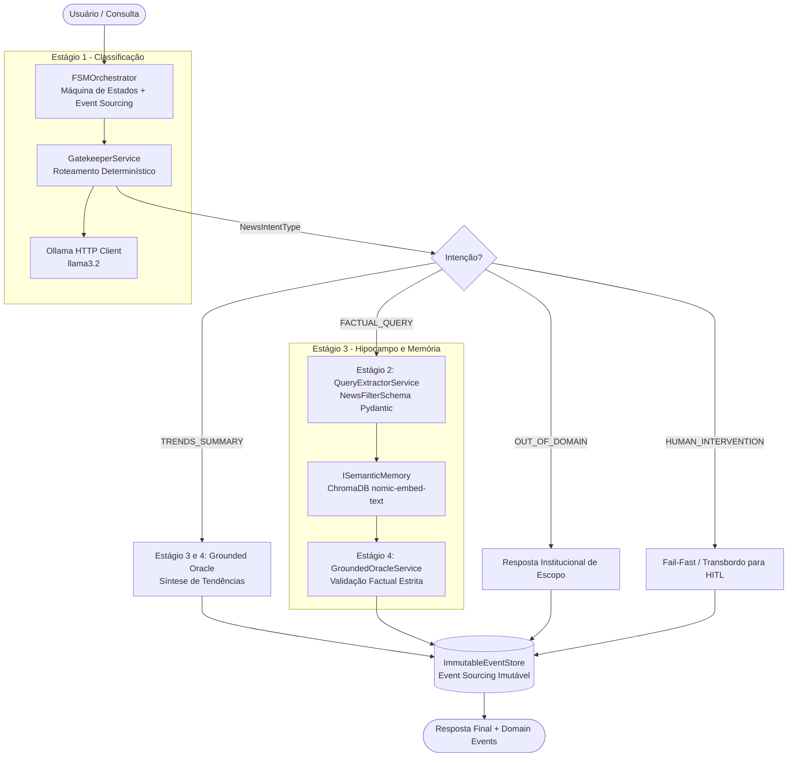

# News Summarizer - On-Premise SLM Architecture


News Summarizer é um sistema autônomo de inteligência de notícias baseado em *Small Language Models* (SLMs) projetado para rodar 100% On-Premise (local) em hardwares de consumo (ex: RTX 3060 12GB). 

O projeto adota princípios avançados de Engenharia de Software, incluindo **Clean Architecture desacoplada de frameworks monolíticos, CQRS, Event Sourcing com Pydantic v2, Funis O(1), FSM (Finite State Machine) e Arquitetura Map-Reduce**, para extrair, filtrar, resumir e vetorizar informações da internet de forma determinística e com privacidade absoluta.

---

## 🏗️ Arquitetura em Estágios (Clean Architecture)

Seguindo os padrões comprovados de engenharia de software com SLMs, o pipeline abandona wrappers monolíticos e adota estágios especializados e fortemente tipados:



### Os 4 Estágios do Pipeline

1. **Estágio 1 — Gatekeeper (`GatekeeperService`):**
   - Classifica deterministicamente a entrada em 4 categorias (`FACTUAL_QUERY`, `TRENDS_SUMMARY`, `OUT_OF_DOMAIN`, `HUMAN_INTERVENTION`).
   - Prompt few-shot otimizado com formatação JSON forçada no backend (`format: json`) e guardrails heurísticos pré-LLM para fail-fast instantâneo.
   - Fallback determinístico de segurança para `HUMAN_INTERVENTION` em caso de erro de conexão ou timeout.

2. **Estágio 2 — Extrator Estruturado (`QueryExtractorService`):**
   - Transforma a linguagem natural do usuário em filtros validados via Pydantic v2 (`NewsFilterSchema`): tópico, palavra-chave, fonte, data de referência e limite.
   - Elimina alucinações e garante consultas higienizadas.

3. **Estágio 3 — Memória Semântica (`ChromaDBAdapter` via `ISemanticMemory`):**
   - Atua como o *Read Model* da arquitetura CQRS.
   - Vetoriza a inteligência destilada usando o modelo leve `nomic-embed-text`.
   - Recuperação isolada do contexto semântico, eliminando contaminação cruzada.

4. **Estágio 4 — Modo Oráculo Estrito & Guardrails Factuais (`GroundedOracleService`):**
   - Injeta estritamente o contexto das notícias na instrução do modelo.
   - Guardrail determinístico contra alucinação: se os fatos não constarem na base ou a busca vetorial estiver vazia, aciona a recusa segura canônica (*"Não possuo dados suficientes em minha base interna para responder a esta pergunta."*) sem inventar informações.

5. **Event Sourcing Auditável (`ImmutableEventStore`):**
   - Todos os eventos (`UserMessageReceived`, `IntentClassified`, `SearchFiltersExtracted`, `ContextRetrieved`, `ResponseGenerated`, `GuardrailTriggered`, `HandoffTriggered`, `HumanCorrectionProvidedEvent`) são imutáveis (`frozen=True`) e registrados para auditoria de ponta a ponta.

---

## ⚡ Funil O(1) e Map-Reduce

1. **Ingestão e Funil O(1) (Filtro Bayesiano e Lexical):**
   - Captura dados de feeds RSS.
   - Utiliza **SimHash (Hamming Distance)** para descartar redundâncias jornalísticas em tempo constante O(1).
   - Utiliza um **Classificador Naive Bayes** (*Cold Start* via `vocabulary_seed.json`) para barrar tópicos irrelevantes antes que consumam ciclos de inferência.

2. **Event Sourcing em Parquet:**
   - A verdade bruta e todos os estados intermediários (Notícias -> Resumos Individuais -> Mega Boletins) são salvos de forma imutável (*append-only*) na camada de persistência via **Polars** (arquivos `.parquet`).

3. **Map-Reduce (Agentes SLM Locais):**
   - **MAP (`OllamaSummarizerAgent`):** Lê artigos extensos e extrai sínteses de 3 parágrafos.
   - **REDUCE (`OllamaMasterAgent`):** Coleta resumos do dia e consolida o Mega-Boletim Executivo cruzando tendências.

---

## 🚀 Instalação e Execução

### Pré-requisitos
* Python 3.12+
* [Ollama](https://ollama.com/) rodando localmente.
* Modelos necessários no Ollama:
  ```bash
  ollama pull llama3.2
  ollama pull nomic-embed-text
  ```

### Instalação
```bash
git clone https://github.com/SEU_USUARIO/news_summarizer.git
cd news_summarizer
python -m venv .venv
source .venv/bin/activate
pip install -r requirements.txt
```

### Como Rodar

#### 1. Demonstração do Pipeline e Event Sourcing
```bash
python main.py
```
Para interagir no terminal em modo chat:
```bash
python main.py --chat
```

#### 2. Funil de Ingestão e Triagem O(1)
```bash
python test_ingestion.py
```

#### 3. Pipeline Map-Reduce e Vetorização
```bash
python test_summarizer.py
```

#### 4. Menu CLI de Leitura de Boletins e Oráculo RAG
```bash
python view_bulletins.py
```

#### 5. Executar a Suíte de Testes Unitários
```bash
pytest -v
```

#### 6. Executar Bateria de Medição e Benchmark
```bash
python tests/medir_pipeline.py --reps 1
```

---

## 🤝 Licença
Distribuído sob a licença MIT. Veja `LICENSE` para mais informações.
